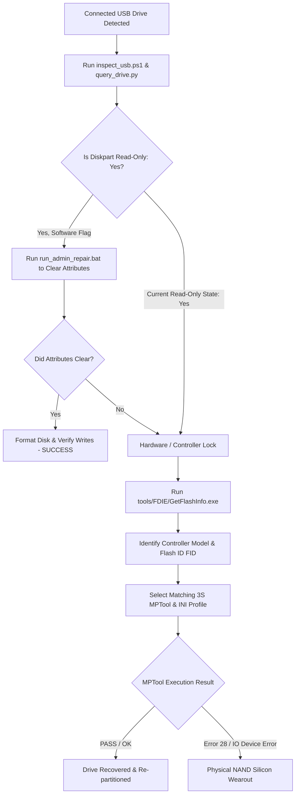

# USB Flash Drive Recovery & Diagnostics Toolkit

<div align="center">

### **Developed by Rawishan** • **ArcEdge Network** • [arcedge.lk](https://arcedge.lk)

[](https://arcedge.lk)
[](https://arcedge.lk)
[](https://arcedge.lk)

</div>

> [!CAUTION]
> # 🛑 CRITICAL NOTICE: RISK OF PERMANENT DATA LOSS & HARDWARE FAILURE
> ## ⚠️ STRONGLY RECOMMENDED: SECURE AND PROTECT YOUR DATA FIRST!
> 
> **BEFORE EXECUTING ANY SCRIPT OR FACTORY TOOL IN THIS REPOSITORY, ENSURE COMPLETE PROTECTION AGAINST DATA LOSS.**
> 
> The tools included herein (low-level mass production formatters, controller ISP flashers, SCSI sector writers, and attribute clean tools) operate below the Windows operating system and bypass standard safety guards:
> 
> - **MANDATORY DATA BACKUP:** We strongly advise taking full backups and protection steps immediately. Any low-level format or ISP re-flash **WILL PERMANENTLY AND IRREVERSIBLY WIPE ALL STORED FILES AND PARTITIONS**.
> - **UNKNOWN HARDWARE STATE:** We do not know what specific drive, controller revision, or NAND degradation state your device possesses. Flash hardware in read-only status is frequently experiencing physical silicon breakdown.
> - **ZERO LIABILITY & NO RISK TAKEN:** Neither **Rawishan**, **ArcEdge Network**, nor **arcedge.lk** accept any liability or take any risks for:
>   - Total or partial data loss.
>   - Irreversibly bricked, dead, or unresponsive USB flash controllers.
>   - Accidental selection or modification of host operating system drives (e.g., Disk 0 NVMe/SSD).
> - **USE AT YOUR OWN RISK:** You are solely responsible for verifying disk indices, drive letters, and NAND compatibility. If you do not know the exact condition of your drive, do not proceed. NO WARRANTY IS EXPRESSED OR IMPLIED.

A comprehensive diagnostic, hardware reverse-engineering, and mass-production toolkit for analyzing and recovering read-only or corrupted USB flash drives on Windows.

Specifically tailored for drives utilizing **Solid State System (SSS / 3S)** and **Toshiba (TC58NC)** controllers (such as `SSS6690`, `SSS6691`, `SSS6692`, `3S6686`, `TC58NC669x`, `TC58NC6623`), but the diagnostic workflow applies to all USB storage devices.

---

## Repository Structure

```text
├── README.md                           # Documentation and recovery guide
├── .gitignore                          # Git exclusions for build/temp artifacts
├── docs/
│   ├── case_study_toshiba_0930_6544.md # In-depth hardware failure analysis
│   └── repair_results.txt              # Diagnostic trace from elevated diskpart run
├── scripts/
│   ├── inspect_usb.ps1                 # Non-destructive USB inspection script
│   ├── query_drive.py                  # Python IOCTL storage descriptor & write probe
│   ├── repair_script.ps1               # Safe elevated attribute cleaner with SSD protection
│   └── run_admin_repair.bat            # UAC elevated batch runner for repair_script.ps1
└── tools/
    ├── FDIE/                           # ANTSpec Flash Drive Information Extractor
    ├── BOOTICE/                        # BOOTICE v1.3.4.0 (x86 & x64) direct SCSI sector tool
    ├── 3S_INI_Config/                  # Eugene Voluzhev 3S INI Configuration Tool
    ├── 3S_MPTool_v2182/                # Solid State System MP Utility v2.182 (with custom INIs)
    ├── 3S_MPTool_v2162/                # Solid State System MP Utility v2.162 (legacy SSS chips)
    └── 3S_MPTool_v3287/                # Solid State System MP Utility v3.287 (6695-6698 chips)
```

---

## Diagnostic Workflow

Follow this systematic procedure when encountering a read-only or locked USB flash drive:



---

## 1. Safety First: Host SSD Protection

`scripts/repair_script.ps1` includes an explicit hardware safety interlock:
- Positively validates **Disk 0** as the primary NVMe/SATA host operating system drive and aborts immediately if targeted.
- Enforces `BusType == 'USB'` before performing any partition or attribute operations.

---

## 2. Using the Diagnostic Scripts

### Step 1: Query Low-Level Drive Properties
Run the non-destructive PowerShell inspector:
```powershell
powershell -ExecutionPolicy Bypass -File scripts\inspect_usb.ps1
```
This gathers:
- Physical disk index, bus type, and partition layout.
- Windows registry `StorageDevicePolicies\WriteProtect` status.
- PnP Hardware IDs (`USB\VID_xxxx&PID_xxxx`).
- SCSI inquiry and device parent relationships.

### Step 2: Probe Hardware Writability (`query_drive.py`)
Run the Python low-level storage probe:
```bash
python scripts/query_drive.py
```
This script queries `IOCTL_DISK_IS_WRITABLE` (0x00070024) and `IOCTL_STORAGE_QUERY_PROPERTY`:
- Returns whether the Windows storage driver reports hardware write protection (`Win32 Error 19: ERROR_WRITE_PROTECT`).
- Dumps the raw SCSI `STORAGE_DEVICE_DESCRIPTOR` strings.

---

## 3. Hardware Interrogation

When Windows-level commands cannot unlock the drive, interrogate the controller chip directly:
1. Open `tools/FDIE/usbflashinfo/GetFlashInfo.exe`.
2. Click **"Get USB Flash Drive Information"**.
3. Note the three critical hardware identifiers:
   - **Controller Part-Number**: (e.g. `TC58NC669x`, `SSS6692`, `PS2251-xx`, `SM3257EN`)
   - **Flash ID (FID)**: (e.g. `98 DE 98 92 72 57`)
   - **Memory Chip Model**: (e.g. `Toshiba TC58TEG6T2JTA00 TLC`)

---

## 4. Factory Mass Production (MP) Tools

This repository includes pre-configured MP utilities for Solid State System controllers:

| Directory | Supported Chips | Description |
| :--- | :--- | :--- |
| `tools/3S_MPTool_v2182/` | `SSS6692`, `3S6686` (`0xB6`), `SSS6691` | Primary factory tool with custom TLC / CM profiles |
| `tools/3S_MPTool_v2162/` | `SSS6690`, `SSS6691`, `SSS6688` | Legacy stable release for earlier SSS controller variants |
| `tools/3S_MPTool_v3287/` | `SSS6695`, `SSS6696`, `SSS6697`, `SSS6698` | 2012 factory release for later SSS architectures |
| `tools/3S_INI_Config/` | SSS Series | Automated INI configuration generator by Eugene Voluzhev |
| `tools/BOOTICE/` | Universal | Low-level SCSI sector editor, partitioner, and MBR builder |

### SSS MPTool Error Code Quick Reference
- **Error 0**: `O.K (No Error)` — Process completed successfully.
- **Error 28**: `DOS format fail` — Low-level erase succeeded, but high-level partition format rejected by host OS or damaged physical blocks.
- **Error 60 / 61**: `ISP code install fail` — The selected `.BIN` firmware does not match the controller ASIC revision.

---

## 5. Software Lock vs. Physical Silicon Breakdown

### How to tell the difference:

| Symptom | Software Lock (Recoverable) | Hardware NAND Breakdown (Unrecoverable) |
| :--- | :--- | :--- |
| **Diskpart Attributes** | `Read-only: Yes` | `Read-only: No`<br>`Current Read-only State: Yes` |
| **Registry Policy** | `WriteProtect = 1` present | Registry clean / no policy active |
| **BOOTICE Sector Write** | Successfully writes LBA 0 | Fails with `I/O device error` at LBA 0 |
| **System Event Log** | No disk error events | **Event ID 153**: `The IO operation at logical block address 0x0 for Disk 1 was retried` |
| **NAND Physics** | Floating-gate oxide intact | Tunnel oxide breakdown; electron leakage causes write gate failure |

---

## Author & Attribution
- **Author**: **Rawishan**
- **Network / Organization**: **ArcEdge Network**
- **Official Website**: [https://arcedge.lk](https://arcedge.lk)

---

## License & Credits
- **Flash Drive Information Extractor**: Copyright © ANTSpec Software ([antspec.com](http://www.antspec.com/usbflashinfo/)).
- **BOOTICE**: Developed by Pauly ([ipauly.com](http://bbs.ipauly.com/)).
- **3S MPTool Profiles & Documentation**: Archived and researched via the [USBDev.ru](https://www.usbdev.ru/) hardware community.
